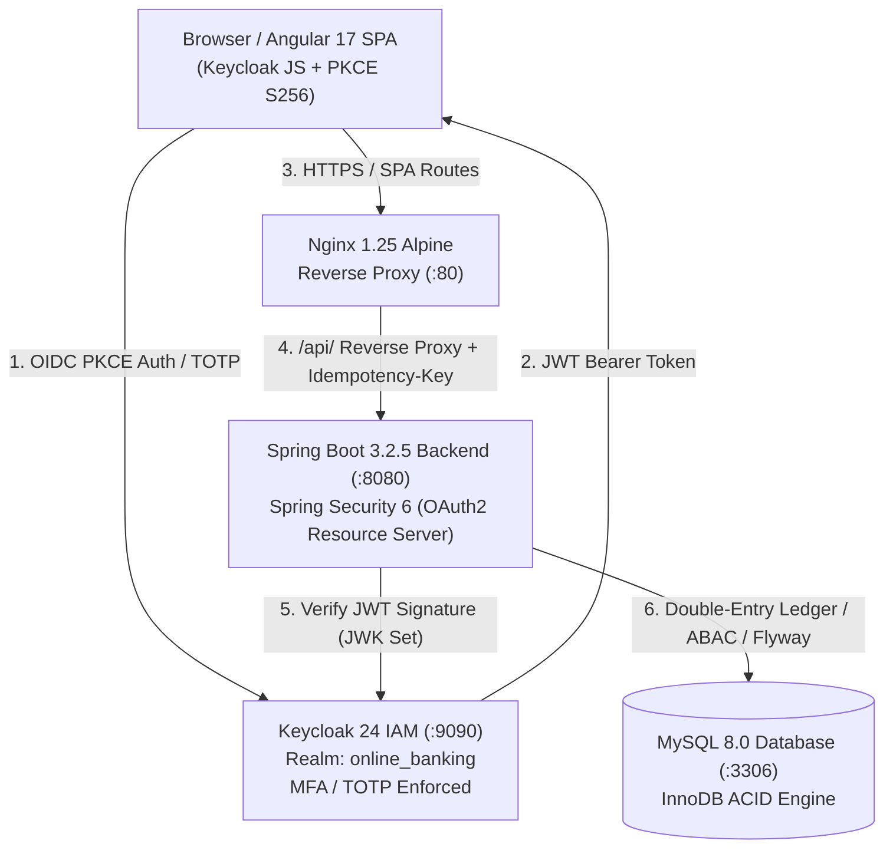

# Online Banking Simulation System

> **Enterprise-Grade Online Banking Architecture** featuring **Java 21 / Spring Boot 3.2.5**, **Angular 17 SPA**, **Keycloak 24 IAM (OIDC + PKCE + Mandatory MFA/TOTP)**, **MySQL 8.0 (Flyway V1–V5)**, and a **Double-Entry Financial Ledger Engine**.

---

## 1. System Overview & Architecture



### Monorepo Structure

```
do_an_an_ninh_da_phuong_tien_online_banking/
├── .env.example                     # Environment configuration template
├── docker-compose.yml               # Multi-container orchestration (MySQL, Keycloak, Backend, Frontend)
├── README.md                        # Master project documentation & deployment guide
├── backend/                         # Java 21 / Spring Boot 3.2.5 Resource Server
│   ├── Dockerfile                   # Multi-stage production container (Maven 3.9 + Temurin 21 JRE)
│   ├── .dockerignore                # Build context optimizations
│   ├── pom.xml                      # Maven project configuration (Spring Security 6, Flyway, Actuator)
│   └── src/
│       ├── main/java/com/onlinebanking/
│       │   ├── config/              # Application & Bean configuration
│       │   ├── dto/                 # Request & Response DTOs with Bean Validation
│       │   ├── entities/            # JPA Entities (UserProfile, Branch, BankAccount, BankTransaction, LedgerEntry, AuditLog)
│       │   ├── repositories/        # Spring Data JPA Repositories
│       │   ├── resources/           # Spring MVC REST Controllers (/api/**)
│       │   ├── security/            # SecurityConfig, KeycloakRoleConverter, ABAC policies, Audit Handlers
│       │   └── services/            # TransferEngine, AccountLifecycle, Idempotency, BranchSync
│       └── main/resources/
│           ├── application.yml      # Spring Boot application profile & properties
│           └── db/migration/        # Flyway SQL migrations (V1__init through V5__transfers)
├── frontend/                        # Angular 17.3.17 Single Page Application
│   ├── Dockerfile                   # Multi-stage production container (Node 20 Alpine + Nginx 1.25)
│   ├── .dockerignore                # Build context optimizations
│   ├── nginx.conf                   # Reverse proxy configuration with SPA fallback & security headers
│   ├── package.json                 # Node dependencies (Keycloak JS, Angular 17)
│   └── src/app/
│       ├── core/                    # Keycloak initialization, AuthInterceptor, AuthGuard, RoleGuard
│       ├── models/                  # TypeScript interfaces & enums
│       ├── services/                # ApiService, AuthService, AccountService, TransferService
│       └── pages/                   # Standalone UI components (Dashboard, Accounts, Transfer, Admin, Staff, Auditor)
└── keycloak/                        # Keycloak realm configuration
    └── online_banking-realm.json    # Realm export (Roles, Client, Users, Mandatory TOTP policy)
```

---

## 2. Security Foundation & Access Control Matrix

### Identity & Authentication
- **Protocol**: OpenID Connect (OIDC) Authorization Code Flow with **PKCE (S256)**.
- **Client**: `online_banking-client` configured as a **Public Client** (zero client secret in SPA).
- **Mandatory MFA / TOTP**: Configured via Keycloak realm required actions (`CONFIGURE_TOTP` set as `defaultAction: true`, 6-digit SHA1, 30s period). Compatible with Google Authenticator, FreeOTP, and Aegis.
- **Brute-Force Protection**: Keycloak rate-limiting and temporary account lockout on successive failed attempts.
- **Stateless Resource Server**: Spring Security 6 resource server validating incoming Bearer JWTs against Keycloak's JWKS endpoint.

### Role-Based Access Control (RBAC) & Separation of Duties (SoD)

| Role | Description | Primary Permissions | Explicit Denials |
|---|---|---|---|
| **CUSTOMER** | Retail Banking Customer | View own accounts & balances, initiate transfers, view own transactions. | Cannot access other customer accounts, staff branch data, or administrative tools. |
| **STAFF** | Branch Officer | View customer profiles and transactions within assigned branch. | **Forbidden from viewing account balances** or initiating transfers. |
| **AUDITOR** | Compliance Auditor | Read-only access to all system audit logs and historical transactions. | Cannot initiate transfers, modify accounts, or update branches. |
| **ADMIN** | Security Administrator | Lock/unlock bank accounts, assign staff to branches, view security logs. | **Strictly forbidden from initiating transfers or viewing balances**. |

### Attribute-Based Access Control (ABAC)
- **Broken Object-Level Authorization (BOLA) Prevention**: `AuthorizationPolicyService` ensures customers can only read and transact from accounts bound to their Keycloak `sub` identity.
- **Branch Isolation**: Staff members are strictly constrained to customer records whose branch code matches the staff member's assigned branch (`STAFF_BRANCH_MISMATCH` audit event logged on unauthorized access).
- **Account State Invariant**: Locked or suspended accounts cannot send or receive funds; admin lock/unlock operations mandate a recorded audit reason.

---

## 3. Financial Transfer Engine & Ledger Integrity

The transfer engine (`TransferService`) guarantees strict financial compliance and concurrency safety:

1. **ACID Transactional Boundary**: Runs within `@Transactional(isolation = Isolation.READ_COMMITTED)`.
2. **Double-Entry Bookkeeping**: Every transfer produces exactly one `BankTransaction` and two immutable `LedgerEntry` records:
   - Debit entry on source account: `entry_type = DEBIT`, `amount = X`.
   - Credit entry on destination account: `entry_type = CREDIT`, `amount = X`.
   - **Financial Invariant**: $\sum \text{Debit} = \sum \text{Credit}$ enforced at both database and application level.
3. **Deadlock-Free Pessimistic Locking**:
   - Accounts are locked using `LockModeType.PESSIMISTIC_WRITE` (`SELECT ... FOR UPDATE`).
   - Locks are acquired in **deterministic lexicographical order** based on account numbers:
     $$\min(\text{acc}_A, \text{acc}_B) \longrightarrow \max(\text{acc}_A, \text{acc}_B)$$
   - Completely eliminates circular lock wait conditions during concurrent bidirectional transfers.
4. **Idempotency Guarantee**:
   - Every `POST /api/transfers` requires a unique `Idempotency-Key` header (UUIDv4).
   - Identical key + identical payload returns the cached result without duplicate ledger entries.
   - Identical key + modified payload triggers an immediate `409 Conflict`.

---

## 4. Pre-Seeded Identities & Test Credentials (this part not correct, don't read it)

The imported realm (`online_banking-realm.json`) is pre-provisioned with standard test accounts:

| Username | Password | Role | Description | Assigned Branch |
|---|---|---|---|---|
| `customer01` | `customer123` | `customer` | Primary retail customer | Central Branch (`BR001`) |
| `staff01` | `staff123` | `staff` | Branch customer service | Central Branch (`BR001`) |
| `admin01` | `admin123` | `admin` | Application security admin | Global / System-wide |
| `auditor01` | `auditor123` | `auditor` | Compliance auditor | Global / Read-only |

> [!NOTE]
> Upon initial login via Keycloak, users will be prompted to scan a QR code using Google Authenticator or FreeOTP to complete mandatory TOTP registration.

---

## 5. Quick Start Guide (Docker Compose Deployment)

### Prerequisites
- Docker Engine 24+ & Docker Compose v2+
- Ports available: `80` (Frontend/Nginx), `8080` (Backend API), `9090` (Keycloak), `3306` (MySQL)

### 1-Step Full Stack Deployment
```bash
# Clone and enter workspace directory
cd do_an_an_ninh_da_phuong_tien_online_banking

# Launch full stack in background
docker compose up -d --build
```

### Service Endpoints
- **Frontend SPA (Nginx)**: `http://localhost/` or `http://localhost:80/`
- **Backend REST API**: `http://localhost:8080/api/`
- **Backend Health Check**: `http://localhost:8080/actuator/health`
- **Keycloak Administration**: `http://localhost:9090/` (Admin credentials: `admin` / `admin`)
- **Keycloak Realm**: `http://localhost:9090/realms/online_banking`

### Stopping the Services
```bash
# Graceful stop preserving database volumes
docker compose down
```

---

## 6. Local Development Environment

### Backend (Java 21 / Spring Boot)
```bash
cd backend

# Run automated test suite (100 tests, H2 in-memory mode)
mvn clean test

# Run application locally connected to local MySQL & Keycloak
mvn spring-boot:run
```

### Frontend (Angular 17)
```bash
cd frontend

# Install Node dependencies
npm ci

# Run unit test suite (Karma + ChromeHeadless, 24 specs)
npm test -- --watch=false --browsers=ChromeHeadless

# Run development server
npm start
# Open http://localhost:4200/ in browser
```

---

## 7. Automated Test Verification Summary

| Test Category | Suite / Class | Specs | Result | Key Invariants Verified |
|---|---|:---:|:---:|---|
| **Security & RBAC** | `SecurityConfigTest` | 15 | **PASSED** | Role hierarchy, 401 Unauthorized, 403 Forbidden, CORS headers |
| **Identity & Branches** | `UserProfileAndBranchServiceTest` | 13 | **PASSED** | Identity sync, Keycloak groups, branch CRUD, user-branch mapping |
| **ABAC & BOLA** | `AbacAuthorizationServiceTest` | 12 | **PASSED** | Customer account isolation, staff branch boundary enforcement |
| **Account Lifecycle** | `AccountManagementLifecycleTest` | 18 | **PASSED** | Creation, deposit, lock/unlock with mandatory audit reason |
| **Transfer Engine** | `TransferServiceTest` | 16 | **PASSED** | Balance sufficiency, self-transfer rejection, locked account rejection |
| **Double-Entry Ledger** | `DoubleEntryLedgerInvariantTest` | 10 | **PASSED** | $\sum\text{Debit} = \sum\text{Credit}$, immutable ledger entries |
| **Idempotency** | `TransferIdempotencyTest` | 8 | **PASSED** | Key reuse replay, payload mismatch 409 Conflict |
| **Concurrency & Locks** | `TransferConcurrencyAndDeadlockTest`| 3 | **PASSED** | 10 concurrent threads, bidirectional transfers, zero deadlocks |
| **Audit & History** | `TransactionHistorySecurityTest` | 5 | **PASSED** | Account number masking (`******1001`), security audit logs |
| **Frontend Karma** | `Karma / ChromeHeadless` | 24 | **PASSED** | Route guards, auth interceptor, role segregation, transfer form |
| **Total Automated** | **100 Backend + 24 Frontend** | **124** | **100% PASS** | **Zero failures, zero regressions** |

---

## 8. License & Project Metadata
- **Course**: An Ninh Da Phuong Tien (Multimedia & Application Security)
- **Frameworks**: Spring Boot 3.2.5, Angular 17.3.17, Keycloak 24.0, Nginx 1.25, MySQL 8.0
- **Architectural Standard**: OAuth 2.0 / OIDC, OWASP API Security Top 10, Double-Entry Accounting

